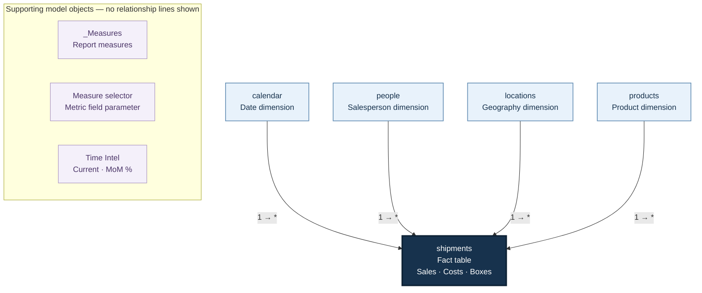

# Chocolate Sales Performance Dashboard

An interactive Power BI report for exploring chocolate sales, costs, profitability, shipment volumes, and low-box shipments. The report combines dynamic metric selection, month-over-month comparisons, and salesperson performance analysis.

## Overview

The dashboard brings together five core metrics: **Sales, Boxes, Shipments, Costs, and Profit**. Users can explore performance using product-category and geography filters, switch the trend metric, and compare the latest month in the dataset with the previous month.

## Key Features

- **Performance cards:** Total Sales, Total Boxes, Total Shipments, Total Costs, and Total Profit, with latest-month values and MoM percentages.
- **Dynamic trend analysis:** A field parameter switches between five metrics, while a dynamic title summarizes the change between the first and last visible months with nonblank values.
- **Profitability monitoring:** Profit margin is compared with a fixed 60% target.
- **Shipment analysis:** A shipment distribution chart and a low-box shipment percentage support shipment-volume analysis.
- **Salesperson performance:** A table displays salesperson pictures, sales, profit, profit margin, and low-box shipment percentage.
- **Interactive filtering:** Product-category and geography slicers support focused analysis.

## Charts and Report Visuals

### Dashboard Preview


### Interactive Tooltip and Product View


### Visual Breakdown

| Visual | What it shows | Interaction or interpretation |
| :--- | :--- | :--- |
| KPI cards | Total Sales, Total Boxes, Total Shipments, Total Costs, and Total Profit | Each card also displays a latest-month value and a MoM percentage. |
| Dynamic line chart | The selected metric across months | Switch between sales, Boxes, Shipments, Costs, and Profit. The title reports the percentage change between the first and last visible months with nonblank values. |
| Profit margin gauge | Overall profit margin | Compares profitability with the 60% profit target. The supplied dashboard screenshot displays 60.3%. |
| Shipment Analysis histogram | Shipment frequency across box-count bins | Shows the distribution of shipment sizes. The horizontal range control supports inspection of different box-count ranges. |
| Low-box shipment gauge | Percentage of shipment rows containing fewer than 50 boxes | The supplied screenshot displays 10.2%; this is a shipment-count ratio, not a share of boxes or sales. |
| Salesperson performance table | Salesperson pictures, Total sales, Total Profit, profit %, and LBS % | Includes in-cell profit-margin bars and status icons. |
| Product performance table | Product-level Total sales, Total Profit, profit %, and LBS % | Provides the product-focused view, with in-cell profit-margin bars and status icons. |
| Geography donut tooltip | Geographic breakdown for the hovered trend context | The supplied tooltip shows a summary value and percentage contributions for Australia, Canada, India, New Zealand, UK, and USA. |
| Category and geography slicers | Product categories and individual countries | Narrow the report to the selected business segment or location. |

> Screenshot values represent the captured report state and will change with filters or refreshed data.

**Displaying the previews on GitHub:** Upload `image (8).png` and `image (2) (3).png` to the same repository folder as this `README.md`, keeping these filenames unchanged. The preview links above use URL-encoded filenames so GitHub can resolve the spaces and parentheses.

## Data Model

### Model Diagram

The report uses a star-schema layout: four dimension tables filter the central shipment fact table through one-to-many, single-direction relationships.



**Reading the diagram:** `1` denotes the dimension side and `*` denotes the many-row shipment side. Arrows indicate the filter direction toward `shipments`. The supporting objects are shown separately because no relationship lines connect them in the supplied model screenshots. Exact relationship-column mappings are not asserted here.

The diagram is embedded directly in this README using Mermaid and renders on GitHub without a separate image file.

The model contains the following tables:

| Table | Role | Confirmed fields or contents |
| :--- | :--- | :--- |
| `shipments` | Shipment fact table | Boxes, Boxes (bins), Costs, Date, Geography, Product, Sales, Sales Person |
| `calendar` | Date dimension | Date, day name, Day of Week, Month, Month Name, Start of Month, Year |
| `people` | Salesperson dimension | Picture, Sales person, Team |
| `products` | Product dimension | Category, Cost per box, Product |
| `locations` | Geography dimension | Geo, Region |
| `_Measures` | Measure organization | Report calculations |
| `Measure selector` | Field parameter | Sales, Boxes, Shipments, Costs, Profit |
| `Time Intel` | Calculation group | Period column; Current and MoM % items |

## Metric Definitions

| Metric | Definition |
| :--- | :--- |
| Total sales | Sum of `shipments[Sales]` |
| Total Boxes | Sum of `shipments[Boxes]` |
| Total Costs | Sum of `shipments[Costs]` |
| Total Shipments | Number of rows in `shipments` |
| Total Profit | Total sales minus Total Costs |
| profit % | Total Profit divided by Total sales |
| LBS Count | Shipment rows with fewer than 50 boxes |
| LBS % | LBS Count divided by Total Shipments |

> Shipment counts treat each row in `shipments` as one shipment. LBS refers here to shipments with fewer than 50 boxes, not shipment weight.

## DAX Implementation

### Core Measures

```dax
Total sales = SUM(shipments[Sales])

Total Boxes = SUM(shipments[Boxes])

Total Costs = sum(shipments[Costs])

Total Shipments = COUNTROWS(shipments)

Total Profit = [Total sales] - [Total Costs]

profit % = DIVIDE([Total Profit],[Total sales])

LBS Count = CALCULATE([Total Shipments],shipments[Boxes]<50)

LBS % = DIVIDE([LBS Count],[Total Shipments])
```

### Latest-Month Reporting

The latest month is derived from the maximum shipment date using `ALL(shipments)`. It is based on the dataset rather than the current system date. The latest-month measures then apply the month's date range to the relevant metric.

```dax
Latest Month Start =
DATE(
    YEAR(MAXX(ALL(shipments), shipments[Date])),
    MONTH(MAXX(ALL(shipments), shipments[Date])),
    1
)

Sales This Month =
VAR _LatestMonthStart = [Latest Month Start]
RETURN
CALCULATE(
    [Total sales],
    DATESBETWEEN(
        'calendar'[Date],
        _LatestMonthStart,
        EOMONTH(_LatestMonthStart, 0)
    )
)
```

The same date-window pattern is used by `Boxes This Month`, `Costs This Month`, `Profit This Month`, and `Shipments This Month`.

> Latest-month values can represent a partial month if the dataset does not contain the entire month.

### Time Intelligence Calculation Group

**Calculation group:** `Time Intel`  
**Column:** `Period`

**Current** returns the selected measure unchanged:

```dax
SELECTEDMEASURE()
```

**MoM %** compares the current-context value with the value obtained by shifting the date context back one month:

```dax
VAR CurrentValue = SELECTEDMEASURE()
VAR PrevMonthValue =
    CALCULATE(
        SELECTEDMEASURE(),
        DATEADD('calendar'[Date], -1, MONTH)
    )
RETURN
    DIVIDE(CurrentValue - PrevMonthValue, PrevMonthValue)
```

Dedicated MoM measures apply this calculation item to each core metric. For example:

```dax
Sales MoM % =
CALCULATE(
    [Total sales],
    'Time Intel'[Period] = "MoM %"
)
```

This pattern is also used for `Boxes MoM %`, `Costs MoM %`, `Profit MoM %`, and `Shipments MoM %`.

> MoM results depend on the active date context. `DIVIDE` returns blank when the previous-period denominator is zero or blank.

### Dynamic Measure Selection

The field parameter defines five available metrics and their display order:

```dax
Measure selector = {
    ("sales", NAMEOF('_Measures'[Total sales]), 0),
    ("Boxes", NAMEOF('_Measures'[Total Boxes]), 1),
    ("Shipments", NAMEOF('_Measures'[Total Shipments]), 2),
    ("Costs", NAMEOF('_Measures'[Total Costs]), 3),
    ("Profit", NAMEOF('_Measures'[Total Profit]), 4)
}
```

`Selected Measure Value` resolves the selected parameter label and returns its corresponding measure. It defaults to sales when the selection does not resolve to exactly one metric.

```dax
Selected Measure Value =
VAR _metricTable =
    SELECTCOLUMNS(
        SUMMARIZE(
            'Measure selector',
            'Measure selector'[Measure selector],
            'Measure selector'[Measure selector Fields],
            'Measure selector'[Measure selector Order]
        ),
        "Metric", 'Measure selector'[Measure selector]
    )
VAR _metric =
    IF(
        COUNTROWS(_metricTable) = 1,
        MAXX(_metricTable, [Metric]),
        "sales"
    )
RETURN
SWITCH(
    _metric,
    "sales", [Total sales],
    "Boxes", [Total Boxes],
    "Shipments", [Total Shipments],
    "Costs", [Total Costs],
    "Profit", [Total Profit],
    [Total sales]
)
```

### Dynamic Trend Title

The title compares the first and last visible months with nonblank selected-metric values. It describes endpoint change, not a regression trend or a month-over-month comparison.

```dax
Trend Title =
VAR _monthScope =
    FILTER(
        ALLSELECTED('calendar'[Start of Month]),
        NOT ISBLANK(
            CALCULATE([Selected Measure Value])
        )
    )
VAR _firstMonth =
    MINX(_monthScope, 'calendar'[Start of Month])
VAR _lastMonth =
    MAXX(_monthScope, 'calendar'[Start of Month])
VAR _firstValue =
    CALCULATE(
        [Selected Measure Value],
        KEEPFILTERS('calendar'[Start of Month] = _firstMonth)
    )
VAR _lastValue =
    CALCULATE(
        [Selected Measure Value],
        KEEPFILTERS('calendar'[Start of Month] = _lastMonth)
    )
VAR _pct =
    DIVIDE(_lastValue - _firstValue, _firstValue)
RETURN
IF(
    ISBLANK(_pct),
    BLANK(),
    IF(
        _pct >= 0,
        "Up by " & FORMAT(_pct, "0.0%"),
        "Down by " & FORMAT(ABS(_pct), "0.0%")
    )
)
```

### Profit Target and Indicators

```dax
Profit Target = 0.6

Gauge Min = 0

Gauge Max = 1

Profit Target Indicator =
IF(
    [Profit %] > [Profit Target],
    2,
    IF(
        [Profit %] > 0.9 * [Profit Target],
        1,
        0
    )
)
```

| Indicator | Profit margin condition |
| :--- | :--- |
| 2 | Above 60% |
| 1 | Above 54% and at or below 60% |
| 0 | At or below 54% |

The comparisons are strict: a margin of exactly 60% returns 1, and exactly 54% returns 0.

### Previous-Month Sales

```dax
Total Sales(prev month) =
CALCULATE([Total sales],PREVIOUSMONTH('calendar'[Date]))
```

## Measure Inventory

The supplied DAX definitions contain **26 measures**, separate from the field parameter and calculation items.

| Group | Measures |
| :--- | :--- |
| Core metrics | Total sales; Total Boxes; Total Costs; Total Shipments; Total Profit; profit %; LBS Count; LBS % |
| Latest month | Latest Month Start; Sales This Month; Boxes This Month; Costs This Month; Profit This Month; Shipments This Month |
| Month-over-month | Sales MoM %; Boxes MoM %; Costs MoM %; Profit MoM %; Shipments MoM % |
| Targets and gauges | Profit Target; Profit Target Indicator; Gauge Min; Gauge Max |
| Dynamic reporting | Selected Measure Value; Trend Title |
| Previous period | Total Sales(prev month) |

## Tools and Techniques

- **Power BI Desktop** for report development and exploration.
- **DAX** for aggregations, ratios, dynamic reporting, and time intelligence.
- **Field parameters** for metric switching.
- **Calculation groups** for reusable time-intelligence logic.

## Getting Started

1. Download or clone the repository containing `project_6.pbix`.
2. Open the file in Power BI Desktop.
3. Explore the report using the product-category and geography slicers.
4. Switch between Sales, Boxes, Shipments, Costs, and Profit to inspect the trend.
5. Review profit margins and low-box shipment percentages alongside sales and profit.

**Refreshing data:** If Power BI requests source paths or credentials, configure them for your environment before refreshing. Source connection details are not included in this README.

## Project File

| File | Description |
| :--- | :--- |
| `project_6.pbix` | Power BI report file |
| `README.md` | Project overview and calculation documentation |
