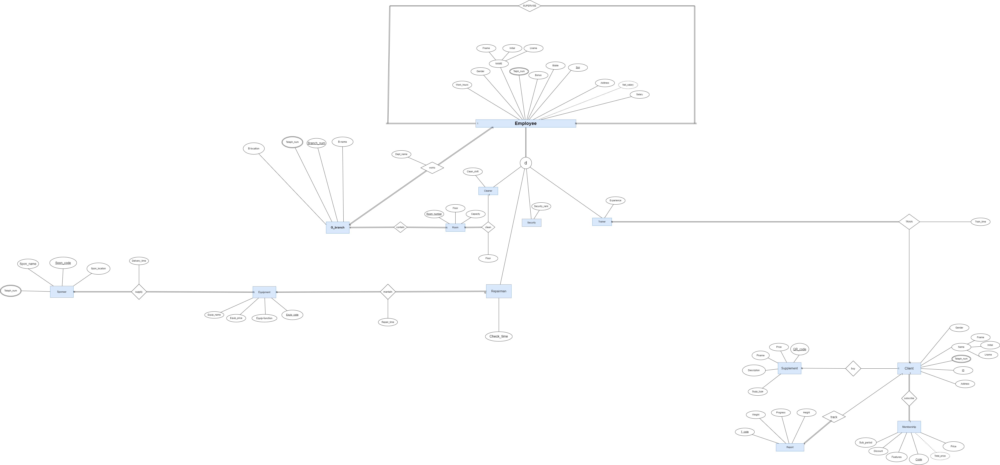
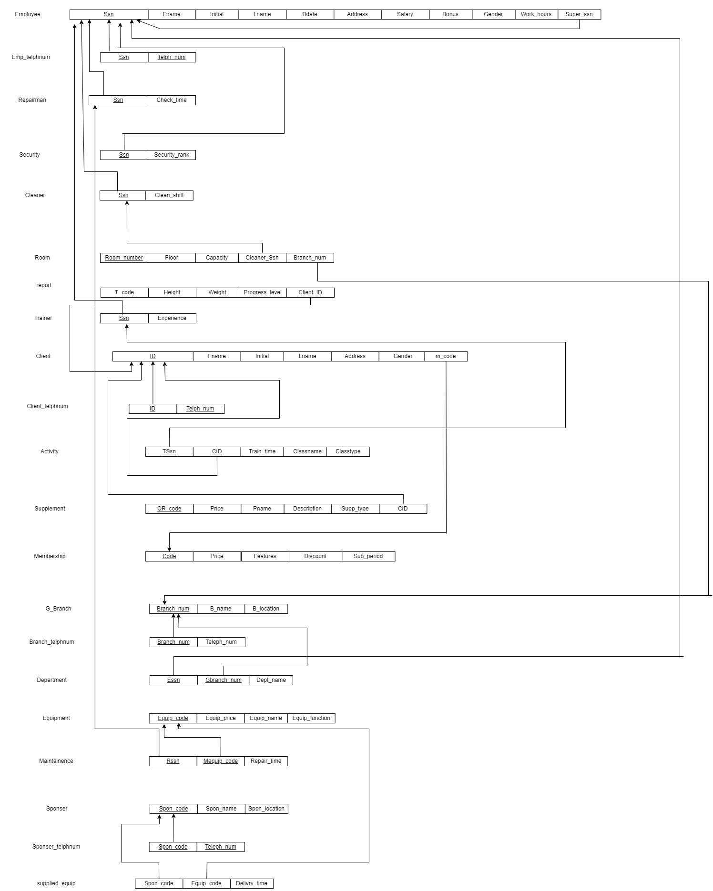

# Gym Management Database

**SQL Portfolio Project · Microsoft SQL Server · T-SQL**

A SQL-focused academic team project modeling gym operations through a relational database and exploring querying, data manipulation, transactions, fragmentation, and distributed database concepts.

> **Portfolio focus:** This project demonstrates SQL skills. Dashboards, Python, and machine learning are intentionally outside its scope.

## Contents

- [Overview](#overview)
- [Database Design](#database-design)
- [SQL Coverage](#sql-coverage)
- [Query Showcase](#query-showcase)
- [Distributed Environment](#distributed-environment)
- [Repository Files](#repository-files)
- [Setup and Validation](#setup-and-validation)
- [Implementation Notes](#implementation-notes)
- [Academic Collaboration](#academic-collaboration)

## Overview

The database connects clients, memberships, employees, branches, departments, training activities, progress reports, equipment, maintenance, suppliers, and supplements.

### Objectives

- Model relationships using primary, foreign, composite, and self-referencing keys.
- Retrieve and summarize operational records using SQL.
- Demonstrate join behavior, subqueries, and set operations.
- Explore transactions and error recovery.
- Demonstrate fragmentation and cross-server querying.
- Extend the academic project with analytical SQL examples.

**Stack:** Microsoft SQL Server, T-SQL, Linked Servers, Registered Servers.

## Database Design

### Entity–Relationship Diagram



### Relational Schema



Keep these images in the same directory as this README. Some names and structures differ between the diagrams and SQL source; the source is the reference for executable identifiers.

| Area | Main tables |
|---|---|
| Employees and roles | `Employee`, `Trainer`, `Cleaner`, `Security`, `repairman` |
| Clients and memberships | `Client`, `Client_telphnum`, `Membership` |
| Training and progress | `Activity`, `Report` |
| Branch operations | `G_branch`, `Department`, `Room` |
| Equipment and maintenance | `Equipment`, `Maintainence` |
| Equipment supply | `Sponser`, `supplied_equipment` |
| Supplements | `supplement` |

Names retain the original implementation's spelling.

## SQL Coverage

| Category | Concepts demonstrated |
|---|---|
| Relational design | Tables, primary keys, foreign keys, composite keys, self-references |
| Query fundamentals | `SELECT`, `WHERE`, `DISTINCT`, `ORDER BY`, `LIKE`, `BETWEEN` |
| Joins | Inner, left, right, full outer, self, multi-table |
| Aggregation | `COUNT`, `SUM`, `AVG`, `MIN`, `MAX`, `GROUP BY`, `HAVING` |
| Subqueries | Scalar subqueries, correlated `EXISTS` and `NOT EXISTS` |
| Set operations | `UNION`, `UNION ALL`, `INTERSECT`, `EXCEPT` |
| Data handling | `CASE`, `NULLIF`, string normalization, type conversion |
| Analytical extensions | CTEs, conditional aggregation, window functions |
| Data manipulation | `INSERT`, `UPDATE`, `DELETE` in the original source |
| Transactions | `TRY...CATCH`, `COMMIT`, `ROLLBACK`, `THROW` |
| Fragmentation | Vertical, horizontal, hybrid |
| Distributed queries | Four-part object names and linked-server access |

**Original work vs. extensions:** CTEs, window functions, conditional aggregation, and data-quality examples below are portfolio extensions rather than claims about the original report.

## Query Showcase

These examples are curated alternatives and extensions. They do not imply that `final_sql_code.sql` has been updated. **They have not been execution-tested during README preparation.** Validate them against your SQL Server environment before relying on their results.

Run local examples in the project database:

```sql
USE Gym;
GO
```

### 01 · Filtering and Sorting

Retrieve employees within a salary range and matching an address keyword.

```sql
SELECT
    e.Ssn,
    CONCAT(e.Fname, ' ', e.Lname) AS EmployeeName,
    e.Salary,
    e.Adress
FROM dbo.Employee AS e
WHERE e.Salary BETWEEN 3000 AND 15000
  AND e.Adress LIKE '%Nasr City%'
ORDER BY e.Salary DESC, e.Ssn;
```

### 02 · INNER JOIN — Clients and Progress Reports

Retrieve male clients with progress classification A.

```sql
SELECT
    c.ID AS ClientID,
    CONCAT(c.Fname, ' ', c.Lname) AS ClientName,
    r.T_code AS ReportCode,
    r.Progress_level
FROM dbo.Client AS c
INNER JOIN dbo.Report AS r
    ON r.Client_ID = c.ID
WHERE LOWER(LTRIM(RTRIM(c.Gender))) = 'male'
  AND r.Progress_level = 'A'
ORDER BY c.ID, r.T_code;
```

An inner join expresses the need for both a client and a matching report. Filtering both sides of a full outer join in `WHERE` would remove unmatched rows.

### 03 · LEFT JOIN — Membership Coverage

Include membership plans with no associated clients.

```sql
SELECT
    m.Code AS MembershipCode,
    m.Feature,
    m.Price,
    COUNT(c.ID) AS ClientCount
FROM dbo.Membership AS m
LEFT JOIN dbo.Client AS c
    ON c.M_code = m.Code
GROUP BY m.Code, m.Feature, m.Price
ORDER BY ClientCount DESC, m.Code;
```

`COUNT(c.ID)` returns zero for an unmatched membership; `COUNT(*)` would count the preserved row.

### 04 · RIGHT JOIN — Filter Matches, Preserve Memberships

Include every membership and its female clients where present.

```sql
SELECT
    m.Code AS MembershipCode,
    m.Feature,
    c.ID AS ClientID,
    CONCAT(c.Fname, ' ', c.Lname) AS ClientName
FROM dbo.Client AS c
RIGHT JOIN dbo.Membership AS m
    ON c.M_code = m.Code
   AND LOWER(LTRIM(RTRIM(c.Gender))) = 'female'
ORDER BY m.Code, c.ID;
```

The gender condition belongs in `ON` to preserve unmatched membership rows.

### 05 · FULL OUTER JOIN — Cleaners and Rooms

Show matches and unmatched records on either side.

```sql
SELECT
    cl.Ssn AS CleanerSSN,
    rm.Room_number,
    rm.Cleaner_ssn AS AssignedCleanerSSN,
    CASE
        WHEN cl.Ssn IS NULL THEN 'Room without matching cleaner'
        WHEN rm.Room_number IS NULL THEN 'Cleaner without room'
        ELSE 'Matched'
    END AS MatchStatus
FROM dbo.Cleaner AS cl
FULL OUTER JOIN dbo.Room AS rm
    ON rm.Cleaner_ssn = cl.Ssn
ORDER BY cl.Ssn, rm.Room_number;
```

With the relevant foreign key enforced, a room referencing a nonexistent cleaner should not occur.

### 06 · SELF JOIN — Employee Supervision

```sql
SELECT
    e.Ssn,
    CONCAT(e.Fname, ' ', e.Lname) AS EmployeeName,
    e.Super_ssn,
    CASE
        WHEN s.Ssn IS NULL THEN 'No supervisor'
        ELSE CONCAT(s.Fname, ' ', s.Lname)
    END AS SupervisorName
FROM dbo.Employee AS e
LEFT JOIN dbo.Employee AS s
    ON s.Ssn = e.Super_ssn
ORDER BY e.Ssn;
```

### 07 · Multi-Table JOIN — Branch Staffing

Retrieve employee assignments for the selected branch.

```sql
SELECT
    e.Ssn,
    CONCAT(e.Fname, ' ', e.Lname) AS EmployeeName,
    d.Dept_name,
    g.Branch_num,
    g.Branch_name
FROM dbo.Employee AS e
INNER JOIN dbo.Department AS d
    ON d.Essn = e.Ssn
INNER JOIN dbo.G_branch AS g
    ON g.Branch_num = d.Gbranch_num
WHERE g.Branch_name = 'elwadi'
ORDER BY e.Ssn;
```

### 08 · GROUP BY and HAVING

Find clients associated with more than one supplement record.

```sql
SELECT
    c.ID AS ClientID,
    CONCAT(c.Fname, ' ', c.Lname) AS ClientName,
    COUNT(*) AS SupplementRecordCount
FROM dbo.Client AS c
INNER JOIN dbo.supplement AS s
    ON s.Cid = c.ID
GROUP BY c.ID, c.Fname, c.Lname
HAVING COUNT(*) > 1
ORDER BY SupplementRecordCount DESC, c.ID;
```

These are associated records, not a documented purchase history.

### 09 · Summary Aggregations

Summarize stored supplement prices by category.

```sql
SELECT
    s.Supp_Type,
    COUNT(*) AS RecordCount,
    MIN(s.Price) AS MinimumPrice,
    MAX(s.Price) AS MaximumPrice,
    AVG(CAST(s.Price AS decimal(18, 2))) AS AveragePrice,
    SUM(CAST(s.Price AS decimal(18, 2))) AS SumOfRecordedPrices
FROM dbo.supplement AS s
GROUP BY s.Supp_Type
ORDER BY s.Supp_Type;
```

The sum is not revenue: payment and sales transactions are not recorded here.

### 10 · Scalar Subquery

Find employees earning more than the overall average salary.

```sql
SELECT
    e.Ssn,
    CONCAT(e.Fname, ' ', e.Lname) AS EmployeeName,
    e.Salary
FROM dbo.Employee AS e
WHERE e.Salary > (
    SELECT AVG(CAST(Salary AS decimal(18, 2)))
    FROM dbo.Employee
)
ORDER BY e.Salary DESC, e.Ssn;
```

### 11 · Correlated EXISTS and NOT EXISTS

Find clients with supplement records without multiplying client rows.

```sql
SELECT
    c.ID,
    CONCAT(c.Fname, ' ', c.Lname) AS ClientName
FROM dbo.Client AS c
WHERE EXISTS (
    SELECT 1
    FROM dbo.supplement AS s
    WHERE s.Cid = c.ID
)
ORDER BY c.ID;
```

Find clients without progress reports.

```sql
SELECT
    c.ID,
    CONCAT(c.Fname, ' ', c.Lname) AS ClientName
FROM dbo.Client AS c
WHERE NOT EXISTS (
    SELECT 1
    FROM dbo.Report AS r
    WHERE r.Client_ID = c.ID
)
ORDER BY c.ID;
```

### 12 · Conditional Aggregation

**Portfolio extension.** Count progress-report classifications per membership.

```sql
SELECT
    m.Code AS MembershipCode,
    COUNT(r.T_code) AS TotalReportRecords,
    SUM(CASE WHEN r.Progress_level = 'A' THEN 1 ELSE 0 END)
        AS GradeAReports,
    SUM(CASE WHEN r.Progress_level = 'B' THEN 1 ELSE 0 END)
        AS GradeBReports,
    SUM(CASE WHEN r.Progress_level = 'C' THEN 1 ELSE 0 END)
        AS GradeCReports
FROM dbo.Membership AS m
LEFT JOIN dbo.Client AS c
    ON c.M_code = m.Code
LEFT JOIN dbo.Report AS r
    ON r.Client_ID = c.ID
GROUP BY m.Code
ORDER BY m.Code;
```

Counts refer to report records, not necessarily unique clients.

### 13 · CTE and Window Functions

**Portfolio extension.** Rank memberships by client count and calculate their share of clients assigned to existing plans.

```sql
;WITH MembershipCounts AS (
    SELECT
        m.Code AS MembershipCode,
        m.Feature,
        COUNT(c.ID) AS ClientCount
    FROM dbo.Membership AS m
    LEFT JOIN dbo.Client AS c
        ON c.M_code = m.Code
    GROUP BY m.Code, m.Feature
)
SELECT
    MembershipCode,
    Feature,
    ClientCount,
    DENSE_RANK() OVER (
        ORDER BY ClientCount DESC
    ) AS PopularityRank,
    CAST(
        100.0 * ClientCount
        / NULLIF(SUM(ClientCount) OVER (), 0)
        AS decimal(6, 2)
    ) AS PercentageOfAssignedClients
FROM MembershipCounts
ORDER BY PopularityRank, MembershipCode;
```

Clients without a membership assignment are excluded from the denominator. `NULLIF` protects against division by zero.

### 14 · ROW_NUMBER — Highest Salary per Branch

**Portfolio extension.** Select one highest-paid employee from each branch's recorded assignments.

```sql
;WITH RankedEmployees AS (
    SELECT
        g.Branch_num,
        g.Branch_name,
        e.Ssn,
        CONCAT(e.Fname, ' ', e.Lname) AS EmployeeName,
        e.Salary,
        ROW_NUMBER() OVER (
            PARTITION BY g.Branch_num
            ORDER BY e.Salary DESC, e.Ssn
        ) AS SalaryPosition
    FROM dbo.Employee AS e
    INNER JOIN dbo.Department AS d
        ON d.Essn = e.Ssn
    INNER JOIN dbo.G_branch AS g
        ON g.Branch_num = d.Gbranch_num
    WHERE e.Salary IS NOT NULL
)
SELECT
    Branch_num,
    Branch_name,
    Ssn,
    EmployeeName,
    Salary
FROM RankedEmployees
WHERE SalaryPosition = 1
ORDER BY Branch_num;
```

Employee ID breaks salary ties. Use salary-based `DENSE_RANK` to return all employees tied for first place.

### 15 · Data Quality Checks

**Portfolio extension.** Inspect duplicate identifiers, inconsistent values, invalid date strings, and self-supervision.

```sql
-- Duplicate supplement identifiers
SELECT QR_code, COUNT(*) AS Occurrences
FROM dbo.supplement
GROUP BY QR_code
HAVING COUNT(*) > 1;

-- Stored and normalized gender values
SELECT
    Gender AS StoredValue,
    LOWER(LTRIM(RTRIM(Gender))) AS NormalizedValue,
    COUNT(*) AS RecordCount
FROM dbo.Client
GROUP BY Gender, LOWER(LTRIM(RTRIM(Gender)));

-- Invalid dates under an explicit day/month/year interpretation
SELECT Ssn, Bdate
FROM dbo.Employee
WHERE Bdate IS NOT NULL
  AND TRY_CONVERT(date, Bdate, 103) IS NULL;

-- Self-supervision for review
SELECT
    Ssn,
    CONCAT(Fname, ' ', Lname) AS EmployeeName,
    Super_ssn
FROM dbo.Employee
WHERE Ssn = Super_ssn;
```

Ambiguous dates still require confirmation against the intended source format.

### 16 · Set Operators

Local examples demonstrate behavior without requiring a second server.

```sql
-- UNION: combine identifiers and remove duplicates
SELECT Ssn FROM dbo.Employee WHERE Salary > 3000
UNION
SELECT Ssn FROM dbo.Employee WHERE Bouns > 1000;

-- UNION ALL: retain duplicate qualifying identifiers
SELECT Ssn FROM dbo.Employee WHERE Salary > 3000
UNION ALL
SELECT Ssn FROM dbo.Employee WHERE Bouns > 1000;

-- INTERSECT: identifiers appearing in both selections
SELECT Ssn FROM dbo.Employee WHERE Salary > 2000
INTERSECT
SELECT Ssn FROM dbo.Employee WHERE Adress LIKE '%Nasr City%';

-- EXCEPT: identifiers in the first selection but not the second
SELECT Ssn FROM dbo.Employee WHERE Gender = 'F'
EXCEPT
SELECT Ssn FROM dbo.Employee WHERE work_hour > 6;
```

Employees with `NULL` work hours are not selected by `work_hour > 6`. Comparing identifiers differs from comparing complete rows across databases.

### 17 · Fragmentation

Temporary tables avoid collisions with permanent fragment tables in the original script. Run each block once per session or drop its temporary tables before repeating it.

**Vertical fragmentation:** split selected employee attributes while retaining a shared identifier.

```sql
SELECT Ssn, Fname, initial, Lname, Adress
INTO #EmployeePersonal
FROM dbo.Employee;

SELECT Ssn, Super_ssn, Salary
INTO #EmployeeEmployment
FROM dbo.Employee;

SELECT
    p.Ssn, p.Fname, p.initial, p.Lname, p.Adress,
    e.Super_ssn, e.Salary
FROM #EmployeePersonal AS p
INNER JOIN #EmployeeEmployment AS e
    ON e.Ssn = p.Ssn;
```

This reconstructs the selected attributes, not every original employee column.

**Horizontal fragmentation:** create complementary client subsets.

```sql
SELECT ID, Fname, initial, Lname, Addresss, Gender, M_code
INTO #MaleClients
FROM dbo.Client
WHERE LOWER(LTRIM(RTRIM(Gender))) = 'male';

SELECT ID, Fname, initial, Lname, Addresss, Gender, M_code
INTO #OtherClients
FROM dbo.Client
WHERE Gender IS NULL
   OR LOWER(LTRIM(RTRIM(Gender))) <> 'male';

SELECT ID, Fname, initial, Lname, Addresss, Gender, M_code
FROM #MaleClients
UNION ALL
SELECT ID, Fname, initial, Lname, Addresss, Gender, M_code
FROM #OtherClients;
```

The complementary subset retains missing and unexpected gender values.

**Hybrid fragmentation:** select columns, then filter rows.

```sql
SELECT QR_code, Pname, Supp_Type
INTO #SupplementBasic
FROM dbo.supplement;

SELECT QR_code, Pname, Supp_Type
INTO #FoodSupplements
FROM #SupplementBasic
WHERE LOWER(LTRIM(RTRIM(Supp_Type))) = 'food';

SELECT QR_code, Pname, Supp_Type
FROM #FoodSupplements;
```

These are materialized copies, not automatically synchronized fragments. No performance improvement is claimed.

### 18 · Transaction Handling — Controlled Update

Run independently in a disposable environment with **no existing transaction**. A successful run changes the salary.

```sql
SET XACT_ABORT ON;

BEGIN TRY
    BEGIN TRANSACTION;

    UPDATE dbo.Employee
    SET Salary = Salary + 500
    WHERE Ssn = 201
      AND Salary IS NOT NULL;

    IF @@ROWCOUNT <> 1
    BEGIN
        THROW 51001,
            'Expected one employee with a non-null salary.', 1;
    END;

    COMMIT TRANSACTION;
END TRY
BEGIN CATCH
    IF XACT_STATE() <> 0
    BEGIN
        ROLLBACK TRANSACTION;
    END;

    THROW;
END CATCH;
```

Rollback occurs before rethrowing an error.

### 19 · Transaction Failure — Intentional Rollback

Run separately with **no existing transaction**. The error is intentional; the update is rolled back.

```sql
SET XACT_ABORT ON;

BEGIN TRY
    BEGIN TRANSACTION;

    UPDATE dbo.Employee
    SET Salary = Salary + 500
    WHERE Ssn = 201
      AND Salary IS NOT NULL;

    IF @@ROWCOUNT <> 1
    BEGIN
        THROW 51002,
            'Expected one employee with a non-null salary.', 1;
    END;

    THROW 51003,
        'Intentional failure to demonstrate rollback.', 1;

    COMMIT TRANSACTION;
END TRY
BEGIN CATCH
    IF XACT_STATE() <> 0
    BEGIN
        ROLLBACK TRANSACTION;
    END;

    THROW;
END CATCH;
```

An explicit error is used rather than assuming an implicitly convertible value will fail.

### 20 · Distributed Query

Join clients and reports across the original SQL Server instances. Replace server references for your environment.

```sql
SELECT
    c.ID AS ClientID,
    CONCAT(c.Fname, ' ', c.Lname) AS ClientName,
    r.T_code AS ReportCode,
    r.Progress_level
FROM [DESKTOP-6R5MU0A\SQLEXPRESS].[Gym].[dbo].[Client] AS c
INNER JOIN
    [DESKTOP-6R5MU0A\SQLEXPRESS2].[Gym2].[dbo].[Report] AS r
    ON r.Client_ID = c.ID
WHERE LOWER(LTRIM(RTRIM(c.Gender))) = 'male'
  AND r.Progress_level = 'A'
ORDER BY c.ID, r.T_code;
```

Linked-server configuration and permissions are prerequisites; four-part names do not configure access automatically.

## Distributed Environment

The academic report describes `Gym` and `Gym2` across `SQLEXPRESS` and `SQLEXPRESS2`, including linked-server access, Registered Servers, and replication configuration.

- **Linked servers:** enable references to remote database objects.
- **Registered Servers:** organize connections and support multi-server query workflows.
- **Replication:** documented in the report; complete automated deployment scripts are not supplied.

## Repository Files

| File | Purpose |
|---|---|
| `README.md` | Overview and curated SQL examples |
| `final_sql_code.sql` | Original implementation and SQL exercises |
| `full_sql_code.txt` | Text-format SQL source |
| `ERD.png` | Entity–relationship diagram |
| `Schema.png` | Relational schema diagram |
| `report_sql .docx` | Academic report |

## Setup and Validation

1. Prepare a disposable SQL Server environment.
2. Review database creation, batch separation, and active database context.
3. Resolve the original data-type and constraint issues.
4. Create tables and load sample data in dependency order.
5. Execute local examples individually and inspect their results.
6. Execute transaction demonstrations separately.
7. Configure remote instances and linked-server permissions for distributed queries.
8. Validate outputs before publishing execution screenshots or results.

The original source is educational material, not an unattended deployment package. Inserts and `SELECT INTO` statements may fail when repeated without resetting the environment.

## Implementation Notes

The original source still requires review; corrected README examples do not modify that file.

- Correct the extra character in the original `EXCEPT` statement.
- Replace the employee–branch Cartesian product with a relationship-based join through `Department` when reporting branch assignments.
- Use text for telephone numbers, preserving leading zeros and accommodating the supplied values.
- Validate birth-date formats before converting text to a date type.
- Establish a consistent discount convention before changing its type and reloading values.
- Validate supplement identifier uniqueness before adding a primary key.
- Check repairman records before adding the missing employee foreign key.
- Roll back transactions before rethrowing errors.
- Keep comments consistent with the tables and operations they describe.
- Interpret `LIKE '%Z%'` as “contains Z,” not “ends with Z.”
- Do not infer morning activity from the ending of a free-text time range.
- Align diagrams, report terminology, and executable schema names.

Changing a column type cannot restore information already lost during insertion; corrected source values may need to be reloaded.

### Limitations

- Sample records are manually entered.
- Membership prices and supplement prices are not recorded revenue.
- Supplement associations are not a complete sales history.
- Progress reports lack a report-date field and do not establish chronological progress trends.
- Text-based training ranges do not constitute dated attendance records.
- No execution-time benchmarks or measured business impact are claimed.
- Stored procedures, triggers, indexing strategy, execution-plan analysis, and isolation-level demonstrations are outside this showcase.

## Academic Collaboration

This project originated as an academic team assignment.

**Team:** Mohamed Wafiq · Maximos Ashraf · Mohamed Abdelnasser

The accompanying report records the team work and responsibilities. This repository presents the overall project; individual CV descriptions should identify each contributor's actual work.

**Portfolio emphasis:** SQL querying, relational design, aggregation, analytical extensions, transaction concepts, and distributed database fundamentals.
